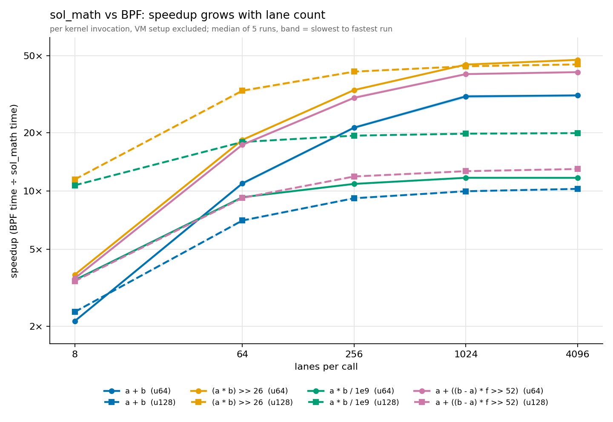
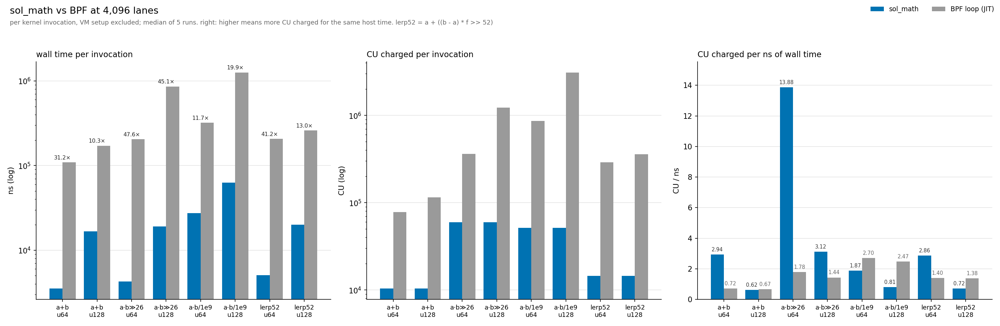

# sol-math

this is poc implementation of a generalizable math intrinsic / syscall.

thank u to phillip from fd for the syscall structure! :D

## run demo

```bash
cd seashell
./scripts/run-math-demo
```

## agave fork syscall implementation

the syscall implementation is available [here](https://github.com/soundsonacid/agave/blob/3fc6e8afa4a7690f01f48c90579eca12f00282aa/syscalls/src/math.rs) (seashell pins this rev)

## syscall signature
```c
sol_math( ulong op_sequence, ulong cnt, void * inputs[3], void * output )
```

## formal defns
1. `op_sequence` - a 64-bit integer containing up to 10 6-bit operations, encoded with polish notation.
    the remaining four (low nibble) bits are used for various flags:
    bit 0 - integer width. 0 = `u64`, 1 = `u128`. input / output buffers are of this type & intermediate math is also done through this type. there is no mixing of integer widths.
    bit 1 - scalar vs vector flag for `inputs[0]`
    bit 2 - scalar vs vector flag for `inputs[1]`
    bit 3 - scalar vs vector flag for `inputs[2]`
2. `cnt` - lane width / length of input vectors. does not apply to scalar inputs
3. `inputs` - up to 3 input scalars or buffers. width determined by `op_sequence` flag
4. `output` - vector or scalar output buffer. may be the same as one of the input buffers. width determined by `op_sequence` flag

## basic behavior:

```
for op, i in op_sequence.enumerate():
    output[i] = do_op(inputs[0][i], inputs[1][i], inputs[2][i])
```

## enabled operations & encoding

the operations in group `11` accept 3 arguments.

```
      dec  bin      class    stack
END     0  00 0000  push     terminates the sequence
A       1  00 0001  push +1  inputs[0] lane (or broadcast)
B       2  00 0010  push +1  inputs[1]
C       3  00 0011  push +1  inputs[2]
LIT     4  00 0100  push +1  next token is the value, 0..63
DUP     5  00 0101  push +1  copy of top

NOT    16  01 0000  unary 0  !x
NEG    17  01 0001  unary 0  -x (wrapping)

ADD    32  10 0000  binary -1  x + y (wrapping)
SUB    33  10 0001             x - y (wrapping)
AND    34  10 0010             x & y
OR     35  10 0011             x | y
XOR    36  10 0100             x ^ y
MIN    37  10 0101             signed min
MAX    38  10 0110             signed max
LSH    39  10 0111             x << y          (y >= width -> 0)
LRSH   40  10 1000             x >> y logical  (y >= width -> 0)
ARSH   41  10 1001             x >> y arithmetic (y >= width -> sign fill)
DIV    42  10 1010             x / y unsigned  (y == 0 -> syscall error)
MOD    43  10 1011             x % y unsigned  (y == 0 -> syscall error)
MUL_LO52 44 10 1100            low 52 bits of (x & 2^52-1) * (y & 2^52-1)
MUL_HI52 45 10 1101            bits 52..103 of the same product

MUL128_DIV 48 11 0000  ternary -2  (x * y) / z, double-width product, truncated to width (z == 0 -> error)
MUL128_SHR 49 11 0001             (x * y) >> z, double-width product, truncated to width (z >= 2*width -> 0)
SELECT     50 11 0010             x != 0 ? y : z
```

## execution

this implementation does not actually lower to hardware operations directly. the syscall is an interpreter for the op sequence & is run on the host machine in native rust code.

if the `avx512f` and `avx512ifma` features are present, `std::arch::x86_64` intrinsics are used for both integer widths, 8 lanes per step with the stack held in `zmm` registers.

u64 lanes (bit width 0): one register per stack slot. a single intrinsic is used for all operations except:
- `DIV`, `MOD`, `MUL128_DIV` have no simd form (there is no simd integer division). after a vector zero-divisor check, each lane runs a scalar divide
- `A`, `B`, `C`, `DUP` are register moves and use none
- `MUL128_SHR` uses a series of intrinsics (the 64x64 -> 128 product from four 32x32 partials, then the shift window)
- `SELECT` uses two intrinsics

u128 lanes (bit width 1): two registers per stack slot, one holding the low 64 bits of all 8 lanes and one the high 64 bits. loads and stores split the interleaved `lo, hi` memory layout into the two limbs with permutes. most operations become a short sequence per limb pair:
- `ADD`, `SUB`, `NEG` carry or borrow between the limbs with a compare mask
- `NOT`, `AND`, `OR`, `XOR` run once per limb
- `MIN`, `MAX` compare the high limbs signed, then the low limbs unsigned where the high limbs are equal
- `LSH`, `LRSH`, `ARSH` select between the count windows below 64, 64..127 and 128 or more
- `MUL_LO52`, `MUL_HI52` only read the low 52 bits, so they run on the low limb alone
- `MUL128_SHR` takes the full 256-bit product (four 64x64 products plus carries) and picks the 128-bit window per lane
- `DIV`, `MOD`, `MUL128_DIV` run per lane in scalar code. `MUL128_DIV` divides the 256-bit product limb by limb when the divisor fits in u64 (four u128-by-u64 divides), and with Knuth's algorithm D (TAOCP vol. 2, 4.3.1) otherwise

if avx-512 is not supported, the same program runs one lane at a time in standard rust arithmetic, for both widths.

note that there is concern around validators not having avx-512 support and increasing execution timing variability. the cost model also makes some assumptions around avx-512 support.

## cost model

```
MATH_BASE_COST     = 100  // once per call
MATH_CU_PER_THING  = 4
MATH_CHUNK_THINGS  = 4    // 3 input loads + 1 store, once per 8-lane chunk (not per op)

things = MATH_CHUNK_THINGS + sum(things(token) for token in op_sequence)
cost   = MATH_BASE_COST + ceil(cnt / 8) * MATH_CU_PER_THING * things
```

`things(token)` is the number of vector instructions the u64 avx-512 path executes for that token on one 8-lane chunk:

```
A, B, C, DUP                          0   register moves
LIT, NOT, NEG, ADD .. ARSH, MUL_*52   1
SELECT                                2   test mask + blend
DIV, MOD                             12   zero check, 2 stores, 8 scalar divides, 1 load
MUL128_DIV                           21   zero check, 3 stores, 8 (mul, div) pairs, 1 load
MUL128_SHR                           25   64x64 -> 128 product (15) + shift window (10)
```

e.g. `a + b` on 64 lanes: `things = 4 + 1 = 5`, `cost = 100 + 8 * 4 * 5 = 260`.

the cu table is a proof of concept, and some of its assumptions don't hold:
- lanes are charged in chunks of 8, so 1 lane costs the same as 8.
- a "thing" is an instruction count, not a time. a scalar divide counts as one thing but takes far longer than a vector add, so the ops with divides are cheaper per ns than the rest. at 4096 u64 lanes, `a * b / 1e9` is charged 1.9 cu per ns of host time against 2.9 for `a + b`.
- most u64 ops are priced well above their cost relative to bpf. at 4096 lanes `a + b`, `MUL128_SHR` and lerp52 are charged 2.9–14 cu per ns, against 0.7–1.8 for the same formulas as bpf loops (right panel of the second chart below), so those entries have room to come down. `a * b / 1e9` is the exception: 1.9 against bpf's 2.7, already cheaper per ns than bpf.
- u128 lanes are charged from the same u64 table, so a u128 call costs exactly the cu of its u64 twin, though every u128 op takes more instructions: two limbs, permutes on every load and store, ~100 instructions for `MUL128_SHR`, and per-lane scalar divides for `MUL128_DIV`. u128 `a + b` and lerp52 are charged 0.6–0.7 cu per ns, at or below the 0.7–1.4 of their bpf loops, so they are underpriced and need a u128 column in the table rather than a cut. u128 `MUL128_SHR` is the exception at 3.1 against 1.4.
- u128 `MUL128_DIV` is charged 0.8 cu per ns against 2.5 for its bpf loop. that is closer to the u64 ops but still below bpf.
- the cu charged doesn't include the ~13 cu of bpf the program spends setting up the call.

exact things table is available [here](https://github.com/soundsonacid/agave/blob/3fc6e8afa4a7690f01f48c90579eca12f00282aa/syscalls/src/math.rs#L148)

## demo results

wall time per kernel invocation, `sol_math` against the same formula written as a bpf loop and run under the sbpf jit, on u64 and u128 lanes.





how it was measured:
- the program runs the kernel N times inside one instruction (repeat count in instruction bytes 24..32), timed at five values of N. the slope of time against N is the cost of one invocation, so vm creation, account serialization and teardown (~14 µs per call, the median fit intercept) drop out.
- every point is sampled in shuffled order, 40 rounds per run, 5 separate processes, pinned to one physical core with its smt sibling idle. each number below is the median over the 5 runs.
- both implementations produce byte-identical outputs before timing starts, and cu is checked to grow linearly in N, so no repeat was optimized away.
- the u128 bpf loops build the 256-bit product from four u64 products. the divide loop takes four u128-by-u64 divides when the divisor fits in u64, as 1e9 does, the same fast path the syscall takes.
- host: AMD EPYC 9275F (zen 5), `host_vector_path() = avx512`, release build.

speedup is bpf ns ÷ sol_math ns; under 1× the syscall is slower.

| formula | width | lanes | sol_math ns | BPF ns | speedup | sol_math CU | BPF CU | sol_math CU/ns | BPF CU/ns |
|---|---|--:|--:|--:|--:|--:|--:|--:|--:|
| `a + b` | u64 | 8 | 115.9 | 246.7 | 2.13× | 146 | 171 | 1.26 | 0.69 |
| `a + b` | u64 | 64 | 158.2 | 1,734 | 10.96× | 286 | 1,235 | 1.81 | 0.71 |
| `a + b` | u64 | 256 | 322.4 | 6,830 | 21.26× | 766 | 4,883 | 2.38 | 0.71 |
| `a + b` | u64 | 1,024 | 882.4 | 27,221 | 30.84× | 2,686 | 19,475 | 3.04 | 0.72 |
| `a + b` | u64 | 4,096 | 3,520 | 108,823 | 31.21× | 10,366 | 77,843 | 2.94 | 0.72 |
| `a + b` | u128 | 8 | 143.1 | 340.2 | 2.38× | 146 | 246 | 1.02 | 0.72 |
| `a + b` | u128 | 64 | 378.8 | 2,670 | 7.05× | 286 | 1,800 | 0.76 | 0.67 |
| `a + b` | u128 | 256 | 1,172 | 10,797 | 9.18× | 766 | 7,186 | 0.65 | 0.67 |
| `a + b` | u128 | 1,024 | 4,292 | 42,838 | 9.98× | 2,686 | 28,670 | 0.63 | 0.67 |
| `a + b` | u128 | 4,096 | 16,710 | 171,523 | 10.26× | 10,366 | 114,722 | 0.62 | 0.67 |
| `(a * b) >> 26` | u64 | 8 | 119.2 | 441.6 | 3.70× | 242 | 735 | 2.03 | 1.66 |
| `(a * b) >> 26` | u64 | 64 | 174.3 | 3,210 | 18.39× | 1,054 | 5,708 | 6.05 | 1.78 |
| `(a * b) >> 26` | u64 | 256 | 382.7 | 12,753 | 33.27× | 3,838 | 22,749 | 10.03 | 1.78 |
| `(a * b) >> 26` | u64 | 1,024 | 1,133 | 50,917 | 45.02× | 14,974 | 90,916 | 13.22 | 1.79 |
| `(a * b) >> 26` | u64 | 4,096 | 4,288 | 204,254 | 47.62× | 59,518 | 363,517 | 13.88 | 1.78 |
| `(a * b) >> 26` | u128 | 8 | 145.4 | 1,671 | 11.49× | 242 | 2,452 | 1.66 | 1.47 |
| `(a * b) >> 26` | u128 | 64 | 405.6 | 13,391 | 33.02× | 1,054 | 19,315 | 2.60 | 1.44 |
| `(a * b) >> 26` | u128 | 256 | 1,299 | 53,798 | 41.40× | 3,838 | 77,138 | 2.95 | 1.43 |
| `(a * b) >> 26` | u128 | 1,024 | 4,855 | 214,432 | 44.13× | 14,974 | 308,444 | 3.08 | 1.44 |
| `(a * b) >> 26` | u128 | 4,096 | 19,050 | 859,533 | 45.11× | 59,518 | 1,233,584 | 3.12 | 1.44 |
| `a * b / 1e9` | u64 | 8 | 189.8 | 659.0 | 3.47× | 226 | 1,716 | 1.19 | 2.60 |
| `a * b / 1e9` | u64 | 64 | 540.5 | 5,026 | 9.30× | 926 | 13,576 | 1.71 | 2.70 |
| `a * b / 1e9` | u64 | 256 | 1,843 | 20,077 | 10.89× | 3,326 | 54,228 | 1.80 | 2.70 |
| `a * b / 1e9` | u64 | 1,024 | 6,854 | 80,247 | 11.71× | 12,926 | 216,839 | 1.89 | 2.70 |
| `a * b / 1e9` | u64 | 4,096 | 27,406 | 321,115 | 11.70× | 51,326 | 867,285 | 1.87 | 2.70 |
| `a * b / 1e9` | u128 | 8 | 233.5 | 2,506 | 10.72× | 226 | 6,085 | 0.97 | 2.43 |
| `a * b / 1e9` | u128 | 64 | 1,095 | 19,636 | 17.94× | 926 | 48,539 | 0.85 | 2.47 |
| `a * b / 1e9` | u128 | 256 | 4,060 | 78,494 | 19.34× | 3,326 | 194,115 | 0.82 | 2.47 |
| `a * b / 1e9` | u128 | 1,024 | 15,894 | 314,603 | 19.79× | 12,926 | 776,239 | 0.81 | 2.47 |
| `a * b / 1e9` | u128 | 4,096 | 63,157 | 1,258,426 | 19.92× | 51,326 | 3,104,989 | 0.81 | 2.47 |
| `a + ((b - a) * f >> 52)` | u64 | 8 | 123.4 | 436.9 | 3.54× | 154 | 581 | 1.25 | 1.33 |
| `a + ((b - a) * f >> 52)` | u64 | 64 | 187.3 | 3,250 | 17.35× | 350 | 4,547 | 1.87 | 1.40 |
| `a + ((b - a) * f >> 52)` | u64 | 256 | 424.3 | 12,889 | 30.32× | 1,022 | 18,138 | 2.41 | 1.41 |
| `a + ((b - a) * f >> 52)` | u64 | 1,024 | 1,286 | 51,807 | 40.20× | 3,710 | 72,455 | 2.89 | 1.40 |
| `a + ((b - a) * f >> 52)` | u64 | 4,096 | 5,055 | 207,141 | 41.16× | 14,462 | 289,790 | 2.86 | 1.40 |
| `a + ((b - a) * f >> 52)` | u128 | 8 | 152.9 | 523.7 | 3.43× | 154 | 722 | 1.01 | 1.38 |
| `a + ((b - a) * f >> 52)` | u128 | 64 | 441.5 | 4,067 | 9.22× | 350 | 5,637 | 0.79 | 1.39 |
| `a + ((b - a) * f >> 52)` | u128 | 256 | 1,374 | 16,335 | 11.90× | 1,022 | 22,475 | 0.74 | 1.38 |
| `a + ((b - a) * f >> 52)` | u128 | 1,024 | 5,122 | 64,865 | 12.67× | 3,710 | 89,900 | 0.72 | 1.39 |
| `a + ((b - a) * f >> 52)` | u128 | 4,096 | 20,023 | 260,374 | 13.00× | 14,462 | 359,403 | 0.72 | 1.38 |

reproduce (the bench needs the program built with the repeat count):

```bash
cargo-build-sbf --manifest-path programs/sol-math/Cargo.toml --features bpf-entrypoint --arch v3
cargo test --release -p seashell --test sol_math_bench --no-run
bench=$(ls -t target/release/deps/sol_math_bench-* | grep -v '\.d$' | head -1)
for i in 1 2 3 4 5; do
  RUST_LOG=error SOL_MATH_BENCH_OUT=target/sol-math-bench/run$i taskset -c 12 \
    "$bench" --ignored --nocapture --test-threads=1
done
scripts/plot-sol-math-bench programs/sol-math/bench target/sol-math-bench/run*
```

`RUST_LOG=error` matters: seashell's default logging writes three lines per instruction to stderr.